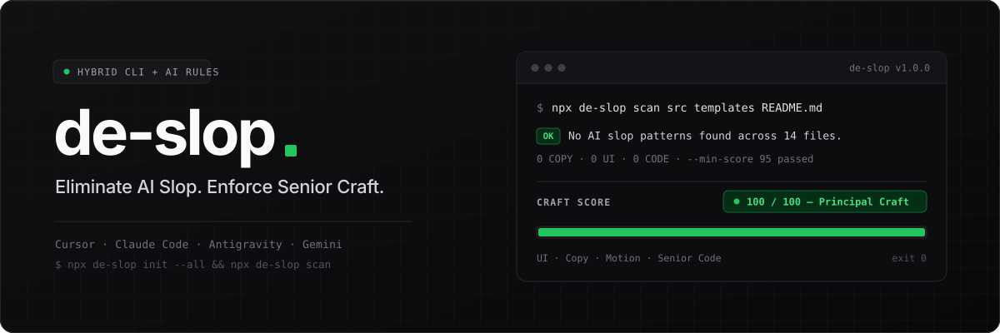

<p align="center">
  
</p>

<p align="center">
  <a href="https://www.npmjs.com/package/@juzy/de-slop"></a>
  <a href="https://github.com/JUZYpeek/de-slop/actions/workflows/ci.yml"></a>
  <a href="./LICENSE"></a>
  
</p>

# `de-slop`

**Eliminate AI slop. Enforce Senior Software Engineer & Principal Designer craft across UI, copywriting, motion, and code.**

`de-slop` is a lightweight, zero-bloat CLI + AI Rules system for Cursor, Claude Code, Antigravity, and Gemini. It pairs **preventive prompt rules** (`de-slop init`) with an **automated codebase linter & Craft Score audit** (`de-slop scan`).

---

## Why `de-slop` Exists

LLM-generated apps share an unmistakable fingerprint: purple-indigo hero gradients, puffy `rounded-3xl shadow-2xl` cards, `transition-all`, hollow copy packed with words like `delve` and `unleash`, narrating `// Set state` comments, and swallowed `catch` blocks.

`de-slop` removes the slop at both ends of your workflow:

1. **Before generation (`init`)** — Installs opinionated engineering and design rules into `.cursorrules`, `CLAUDE.md`, `.antigravity/rules.md`, and `.gemini/styleguide.md` without overwriting your existing instructions.
2. **Before merge (`scan`)** — Audits `.ts`, `.tsx`, `.js`, `.jsx`, `.css`, `.html`, and `.md` files, pinpoints exact offending lines with concrete **Senior Fix** suggestions, applies safe `--fix` cleanups, and computes a **0–100 Craft Score**.

---

## Before `de-slop` vs. After `de-slop`

### 1. UI & Tailwind Classes

| Before `de-slop` (AI Slop) | After `de-slop` (Senior Craft) |
| --- | --- |
| `bg-gradient-to-r from-purple-600 to-indigo-600` hero background | `bg-white dark:bg-neutral-950` neutral canvas with one intentional accent |
| `rounded-3xl shadow-2xl backdrop-blur-2xl` card chrome | `rounded-xl border border-neutral-200/80 dark:border-white/10 shadow-sm` |
| `bg-gradient-to-r from-purple-400 to-pink-500 bg-clip-text text-transparent` | Solid high-contrast ink (`text-neutral-950 dark:text-neutral-50 tracking-tight`) |
| `transition-all duration-300 hover:scale-110` | `transition-colors duration-150 ease-out active:scale-[0.98] focus-visible:ring-2` |

### 2. Copywriting (Microcopy & Headlines)

```text
BEFORE (AI Slop):
  Headline:  "Unleash the power of seamless workflow elevation"
  CTA:       "Get Started Today"
  Error:     "Something went wrong. Please try again."

AFTER (Senior Craft):
  Headline:  "Run preview checks on every pull request in under 12 seconds."
  CTA:       "Deploy to production"
  Error:     "Could not deploy release: npm token expired. Run `npm login` and retry."
```

### 3. TypeScript & React Code

```tsx
// BEFORE (AI Slop)
// Import dependencies
export function SloppyHero(props: any) {
  // Set state
  const [status, setStatus] = useState('idle');
  // Handle click
  const onClick = async () => {
    try { await fetch('/api/launch'); } catch (err) {}
  };
  const label = props.isEnterprise ? 'Enterprise' : props.isPro ? 'Pro' : 'Free';
  return <button onClick={onClick}>{label} ({status})</button>;
}

// AFTER (Senior Craft)
export interface HeroProps {
  tier: 'free' | 'pro' | 'enterprise';
  onLaunch: () => Promise<void>;
}

const TIER_LABELS: Record<HeroProps['tier'], string> = {
  free: 'Free',
  pro: 'Pro',
  enterprise: 'Enterprise',
};

export function LaunchControl({ tier, onLaunch }: HeroProps) {
  const [error, setError] = useState<string | null>(null);

  async function handleLaunch() {
    setError(null);
    try {
      await onLaunch();
    } catch (err) {
      setError(err instanceof Error ? err.message : 'Launch request failed.');
    }
  }

  return (
    <div>
      <button type="button" onClick={handleLaunch}>
        Launch {TIER_LABELS[tier]}
      </button>
      {error ? <p role="alert">{error}</p> : null}
    </div>
  );
}
```

---

## Quick Start

### 1. Inject Senior Craft Rules Into Your AI Editor

```bash
# Interactive setup
npx @juzy/de-slop init

# Or target specific configs directly
npx @juzy/de-slop init --cursor
npx @juzy/de-slop init --claude
npx @juzy/de-slop init --antigravity
npx @juzy/de-slop init --gemini
npx @juzy/de-slop init --all
```

Rules are wrapped between `<!-- de-slop:start -->` and `<!-- de-slop:end -->` markers. Existing instructions in `CLAUDE.md`, `.cursorrules`, `.antigravity/rules.md`, or `.gemini/styleguide.md` stay untouched, and re-running `de-slop init` updates the managed block idempotently.

### 2. Audit Your Codebase for AI Slop

```bash
# Scan the current repository
npx @juzy/de-slop scan

# Scan a specific file or directory
npx @juzy/de-slop scan src/components

# Automatically remove safe narrating comments and cliché copy phrases
npx @juzy/de-slop scan src --fix

# Enforce a minimum Craft Score in CI
npx @juzy/de-slop scan src --min-score 90
```

Example terminal output:

```text
de-slop v1.0.0  ·  craft audit

tests/fixtures/sloppy-hero.tsx (18 issues)
  1:1     [CODE] med   code/narrating-comment
          // Import dependencies
          Why: Comment narrates obvious code structure instead of explaining a non-obvious "why".
          Fix: Delete the narrating comment; rely on clear function and variable names. (auto-fixable)
  18:67   [UI]   high  ui/ai-purple-gradient
          <section className="relative overflow-hidden bg-gradient-to-r from-purple-600 to-indigo-6...
          Why: Default LLM purple-indigo gradient makes the UI look instantly template-generated.
          Fix: Use a crisp neutral surface (bg-white dark:bg-neutral-950) with a 1px hairline border...
  21:11   [COPY] med   copy/ai-buzzword
          Unleash the power of seamless workflow elevation
          Why: Classic LLM marketing hype phrase that adds zero concrete information.
          Fix: Start directly with the verb or action: "Automate...", "Build...", or "Use...". (auto-fixable)

────────────────────────────────────────────────────────────────
Craft Score    4 / 100  █░░░░░░░░░░░░░░░░░░░  AI Slop Detected
Files: 1 scanned (1 flagged)  ·  4 COPY · 8 UI · 6 CODE
Hint: Run with --fix to clean 5 safe auto-fixable issues.
```

---

## CLI Reference

### `de-slop init`

| Flag | Description |
| --- | --- |
| `--cursor` | Install rules into `.cursorrules` |
| `--claude` | Install rules into `CLAUDE.md` |
| `--antigravity` | Install rules into `.antigravity/rules.md` |
| `--gemini` | Install rules into `.gemini/styleguide.md` |
| `--all` | Install into all four configuration paths |
| `-r, --rules <list>` | Subset of rule modules (`base,ui,copy,code`) |
| `-d, --dir <path>` | Target project root (defaults to current working directory) |

### `de-slop scan [targets...]`

| Flag | Description |
| --- | --- |
| `--fix` | Apply safe automated fixes (narrating comments, unambiguous buzzword phrases, `Lorem ipsum` placeholders) |
| `--json` | Emit structured JSON output for tooling or dashboards |
| `--min-score <n>` | Exit with status code `1` if the Craft Score is below `n` |
| `-c, --category <cat>` | Filter audit to `copy`, `ui`, or `code` |

### Inline Suppressions

When an exception is intentional, suppress a single line or file explicitly:

```ts
// de-slop-ignore-next-line code/explicit-any
const legacyPayload: any = parseExternalFixture();

// de-slop-ignore-file
```

---

## Rule Modules (`templates/`)

- [`templates/base-craft.md`](./templates/base-craft.md) — Core doctrine and the Pre-Ship Craft Gate checklist.
- [`templates/ui-and-motion.md`](./templates/ui-and-motion.md) — Neutral surface hierarchy, hairline borders, `tabular-nums`, button state matrices, GPU-composited motion, and `prefers-reduced-motion`.
- [`templates/human-copy.md`](./templates/human-copy.md) — Explicit `BANNED WORDS` vs. `REPLACE WITH` dictionary and Stripe/Linear-style microcopy rules.
- [`templates/senior-code.md`](./templates/senior-code.md) — Guard clauses, strict typing, non-empty error handling, and comment discipline.

---

## Architecture

```text
de-slop/
├── bin/cli.js                  # Executable CLI entrypoint
├── src/
│   ├── index.ts                # Commander router & programmatic exports
│   ├── types.ts                # Shared strict TypeScript contracts
│   ├── commands/
│   │   ├── init.ts             # Non-destructive rule merger & TTY selector
│   │   └── scan.ts             # Recursive walker, --fix runner & threshold gate
│   ├── analyzer/
│   │   ├── index.ts            # Rule runner, suppression parser & Craft Score
│   │   ├── copyRules.ts        # Prose/JSX/HTML copy extractor & cliché rules
│   │   ├── uiRules.ts          # Tailwind/CSS anti-pattern & motion checks
│   │   └── codeRules.ts        # Narrating comments, empty catches, ternaries, any
│   └── utils/
│       └── logger.ts           # Minimal terminal UI with picocolors
├── templates/                  # Curated prompt rule modules
└── tests/                      # Vitest test suite & fixtures
```

---

## Contributing

See [CONTRIBUTING.md](./CONTRIBUTING.md) for the full rule-authoring guide, fixture conventions, and auto-fix safety checklist.

```bash
npm run typecheck
npm run build
npm test
node bin/cli.js scan src templates README.md --min-score 95
```

## License

MIT
